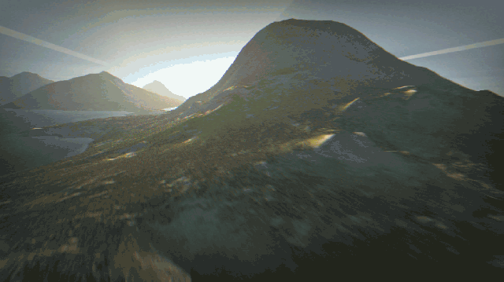

# MIRAGE

[](https://github.com/jfrelat-lab/mirage-x86/actions/workflows/test.yml) [](LICENSE) [](https://mirage-x86.pages.dev) [](https://mirage-x86.pages.dev) [](package.json) [](docs/ARCHITECTURE.md)

### DOS games, Linux programs and the demoscene's Windows intros, run from their original binaries in your browser tab.

**An x86 PC written in plain JavaScript. A dynamic recompiler turns x86 machine code into JavaScript
source, and DOS, Linux's system calls and the Win32 API are built in: a `.COM`, an ELF or an `.exe`
runs at once, with no operating system to boot.**

No WebAssembly, no build step, no dependencies beyond its sibling [PRISM](https://github.com/jfrelat-lab/prism)
(a submodule, for OpenGL and Direct3D 9). It runs in a browser and in Node.

**Try it: [mirage-x86.pages.dev](https://mirage-x86.pages.dev)** — Windows 4K intros, Linux programs of
1997, DOS games and demos, boot sectors and a FreeDOS disk, each a click away.

<p align="center"><a href="https://mirage-x86.pages.dev/machines.html?m=win32&run=win32%2Felevated-2009"></a><br><sub><b>Elevated</b> (RGBA &amp; TBC, 4K, 2009): the Windows executable, unmodified, running in MIRAGE in a browser tab</sub></p>

<table>
<tr>
<td align="center" width="25%"><a href="https://mirage-x86.pages.dev/machines.html?m=win32&run=win32%2Felevated-2009"></a><br><sub><b>Elevated (4K, 2009)</b><br>Windows · Direct3D 9</sub></td>
<td align="center" width="25%"><a href="https://mirage-x86.pages.dev/machines.html?m=win32&run=win32%2Fhartverdrahtet-2012"></a><br><sub><b>Hartverdrahtet (4K, 2012)</b><br>Windows · OpenGL</sub></td>
<td align="center" width="25%"><a href="https://mirage-x86.pages.dev/machines.html?m=linux&run=linux%2Fdoom-x11"></a><br><sub><b>DOOM on X11 (1997)</b><br>Linux · built inside MIRAGE</sub></td>
<td align="center" width="25%"><a href="https://mirage-x86.pages.dev/machines.html?m=linux&run=linux%2Fmesa-1997"></a><br><sub><b>Mesa 2.2 (1997)</b><br>Linux · OpenGL in software</sub></td>
</tr>
<tr>
<td align="center" width="25%"><a href="https://mirage-x86.pages.dev/dos.html?zip=examples%2Fgames%2Funreal11.zip&run=UNREAL"></a><br><sub><b>Unreal (1992)</b><br>DOS · Sound Blaster</sub></td>
<td align="center" width="25%"><a href="https://mirage-x86.pages.dev/dos.html?load=examples%2Fintros%2Fpuls.com&run=puls"></a><br><sub><b>Puls (256 bytes, 2009)</b><br>DOS · x87</sub></td>
<td align="center" width="25%"><a href="https://mirage-x86.pages.dev/boot.html?img=examples%2Fboot%2Ffreedos.img.gz&cpu=586&mem=64"></a><br><sub><b>FreeDOS 1.4</b><br>Bare PC · boots</sub></td>
<td align="center" width="25%"><a href="https://mirage-x86.pages.dev/#boot"></a><br><sub><b>Windows 98</b><br>Bare PC · your own disk</sub></td>
</tr>
</table>

<sub>Every picture is a frame MIRAGE drew. Screenshots of Microsoft products used with permission from Microsoft.</sub>

- **Windows with no Windows**: Elevated, Ergon and ten more 4K intros, their Win32, OpenGL and Direct3D 9 in JavaScript.
- **Linux with no kernel**: Debian 12's bash, id's DOOM and Quake, XFree86 3.3; gcc 2.7.2 builds DOOM inside it.
- **Checked, not assumed**: gcc's 1,586 torture tests print what Docker prints (all but one); 44 programs pinned pixel for pixel.
- **450 million x86 instructions a second** on Dhrystone, as JavaScript.

```
 x86 machine code ─▶ decoder ─▶ JS source ─▶ new Function ─▶ the engine's own JIT ─▶ run
                     (block by block, cached by linear address, aware of self-modifying code)
```

Four machines share one CPU: **Windows** (MIRAGE-WIN32, `machines.html?m=win32`), **Linux**
(MIRAGE-LINUX, `machines.html?m=linux`), **DOS** (`dos.html`: DOS, BIOS, XMS, EMS and a DPMI host in
JavaScript) and a **bare PC** (`boot.html`: BIOS, VGA and VBE, IDE, CD-ROM, Sound Blaster, OPL3 and
MIDI, enough to boot Windows 95 and 98 from their own disks).

## What runs today

| | Reaches |
|---|---|
| Windows intros (MIRAGE-WIN32) | 12 of the scene's 4K and 1K intros, 2007–2017, OpenGL and Direct3D 9 |
| Linux programs (MIRAGE-LINUX) | Debian 12, XFree86 3.3 and its clients, DOOM and Quake, Mesa, the scene's Linux intros |
| DOS | games and demos in real mode, with EMS/XMS and DOS extenders |
| Operating systems (bare PC) | Windows 3.0 to ME to the desktop, Linux 2.2 and 2.4, QNX, KolibriOS, OpenBSD, FreeDOS |

Not yet: Windows NT and 2000, ReactOS, BeOS, networking, 64-bit. Per-title status is in
[docs/COMPATIBILITY.md](docs/COMPATIBILITY.md), what fails and why in [docs/KNOWN-ISSUES.md](docs/KNOWN-ISSUES.md).

## How fast

Linux programs run at 450–460 M x86 instructions a second on Dhrystone; Windows 98 reaches its desktop
in about 36 s. On 16-bit real-mode code MIRAGE leads: BYTE's Sieve runs in 4.9 s headless and 6.7 s in
the page, against 6.2 s for native DOSBox-X. The WebAssembly emulators are faster on 32-bit code — v86
by 2.5 to 4 times on DOS, v86 and CheerpX by 6 to 9 times on Linux — and MIRAGE is ahead of js-dos and
RetroTick. [docs/BENCHMARKS.md](docs/BENCHMARKS.md) has every
figure and how to reproduce it.

## Quick start

```bash
python3 tools/serve.py 8761      # with the oasis-fetch relay OASIS images are fetched through; any static server runs the rest
# http://localhost:8761/            the home page, with the examples
# http://localhost:8761/machines.html  DOS, Linux, Windows and the bare PC on one page
# http://localhost:8761/dos.html    the DOS player: drop a .COM, .EXE or a folder
# http://localhost:8761/boot.html   the bare PC: boot a floppy, hard-disk or ISO image
```

```bash
git clone --recursive https://github.com/jfrelat-lab/mirage-x86   # PRISM is a submodule
node tools/test.js                # the unit suite
npm run test:all                  # every suite that needs nothing outside the repository
```

Node 22 (what it is developed on). The assembly sources under `demos/` and `tools/` need `nasm` only if you change
them; the assembled demos are checked in.

## How it is tested

Against other machines, not against its own expectations: a unit suite whose every test fails when its
fix is reverted, 44 golden programs, single-instruction tests against SingleStepTests and Unicorn,
probe programs run unchanged under QEMU and MIRAGE, and whole-system comparisons with QEMU, DOSBox-X
and v86. [docs/TESTING.md](docs/TESTING.md) has the details.

## Documentation

Start with [docs/ARCHITECTURE.md](docs/ARCHITECTURE.md); [docs/README.md](docs/README.md) lists the
rest — the recompiler, the devices, the machine a guest sees, what runs and what does not, the tests,
OASIS images, the comparison with other emulators, the roadmap — and [CHANGELOG.md](CHANGELOG.md) what
changed. [docs/notes/](docs/notes/README.md) keeps the investigations as they were written.

## Third-party software

The repository holds MIRAGE, its own small demos (`demos/`) and the home page's **examples**
(`examples/`): programs their authors allow passing on, each with its licence in `examples/licenses/`
([examples/README.md](examples/README.md)), and a FreeDOS 1.4 disk whose source is served beside it.
OASIS images are recipes: what they run is fetched from where its authors published it (Debian,
idgames, scene.org). [PRISM](https://github.com/jfrelat-lab/prism) is a submodule (MIT; its
[THIRD-PARTY.md](https://github.com/jfrelat-lab/prism/blob/main/THIRD-PARTY.md)). Anything else you
run — `boot/`, `games/`, `intros/`, ignored by git — is yours to bring.

## How it was built

MIRAGE was written with [Claude Code](https://claude.com/claude-code).

## License

[MIT](LICENSE). The licence covers MIRAGE itself, not the software you run on it.
