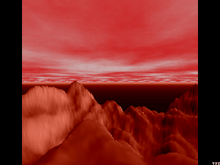
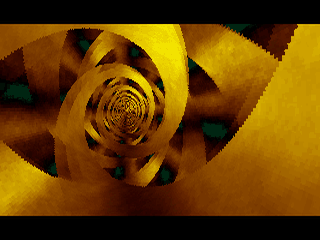

# MIRAGE — Compatibility

What has been run on MIRAGE and how far it got. None of this software is in the repository; the
pictures beside each entry are MIRAGE's own captures of it (`docs/compat/`).

**How to read the tables**

| Status | Meaning |
|---|---|
| 🟢 **Plays** | interactive and working as far as it was exercised (a level, a demo loop, a shell) |
| 🟢 **Renders** | reaches and correctly draws the screen named in the notes; not played further |
| 🟠 **Starts** | runs, but stops short of its main screen for the reason given |
| 🔴 **Fails** | does not get there; see [KNOWN-ISSUES.md](KNOWN-ISSUES.md) when the cause is known |
| 🟠 **Unknown** | the last result predates a change that probably affects it |

**Run** is the date the entry was last run. **2026-11-05 is a full sweep**: every title whose
files were at hand was run again that day — DOS games headless (`tools/shot.mjs`), systems headless
(`tools/v86/bootshot.mjs`), intros and the Windows and Linux machines in headless Chrome with its GPU.
An older date means the title was not re-run (its files were not at hand), and the result may be
stale. The sweep found four regressions, all fixed the same day: KolibriOS, xcom144 and FreeNOS
stopped booting, and the derail detector cried wolf on KolibriOS. The stories behind many entries
are in [notes/](notes/README.md), chiefly [notes/compat-log.md](notes/compat-log.md).

---

## Operating systems (the bare PC, `boot.html`)

Images are v86's pre-installed disks unless marked *official media*. "Options" are what the image
needs beyond the defaults (16 MiB, the `386` profile, no PCI).

| &nbsp;&nbsp;&nbsp;&nbsp;&nbsp;&nbsp;&nbsp;&nbsp;&nbsp;&nbsp;&nbsp;&nbsp;&nbsp;&nbsp;&nbsp;&nbsp;&nbsp;&nbsp;&nbsp;&nbsp;&nbsp;&nbsp;&nbsp;&nbsp;&nbsp;&nbsp;&nbsp;&nbsp;&nbsp;&nbsp;&nbsp;&nbsp;&nbsp;&nbsp;&nbsp;&nbsp;&nbsp;&nbsp;&nbsp;&nbsp;&nbsp;&nbsp;&nbsp;&nbsp;&nbsp;&nbsp;&nbsp;&nbsp;&nbsp;&nbsp;&nbsp;&nbsp;&nbsp;&nbsp;&nbsp;&nbsp;&nbsp;&nbsp;&nbsp;&nbsp;&nbsp;&nbsp;&nbsp;&nbsp;&nbsp;&nbsp;&nbsp;&nbsp;&nbsp;&nbsp;&nbsp;&nbsp;&nbsp;&nbsp;&nbsp;&nbsp;&nbsp;&nbsp;&nbsp;&nbsp;&nbsp;&nbsp;&nbsp;&nbsp;&nbsp;&nbsp;&nbsp;&nbsp;&nbsp;&nbsp;&nbsp;&nbsp; | System | Status | Reaches | Options | Run |
|---|---|---|---|---|---|
|  | Windows 3.0, real mode (`win /r`, as `W30HD.IMG`'s AUTOEXEC.BAT starts it, on its MS-DOS 4) | 🟢 Plays | Program Manager | — | 2026-11-05 |
|   | Windows 3.0, standard mode (`win /s`) | 🟢 Plays | Program Manager, on `W30HD.IMG`'s MS-DOS 4 (left) and on MIRAGE's built-in DOS (`tools/win30.mjs /s`, right); it failed on the built-in DOS with "Cannot load Windows in standard mode" until 2026-09 | — | 2026-11-05 |
|  | Windows 3.0, 386 enhanced mode (`win /3`) | 🟢 Plays | Program Manager on `W30HD.IMG`'s MS-DOS 4, paging on, WIN386 at 0028:8000xxxx. On MIRAGE's built-in DOS it stops with "Cannot install the 386 enhanced mode Expanded Memory driver": its V86MMGR wants to take over a real HIMEM.SYS | — | 2026-11-05 |
|  | Windows 3.1, standard mode | 🟢 Plays | Program Manager at 1024×768×256, pixel-identical to QEMU | — | 2026-11-05 |
|  | Windows 95 | 🟢 Plays | the desktop (Enter at its three dialogs) | 64 MiB, `586` | 2026-11-05 |
|  | Windows 98 | 🟢 Plays | the desktop | 64 MiB, `586` | 2026-11-05 |
|  | Windows ME | 🟢 Plays | the desktop, after ScanDisk and its display settings (Esc at the hardware wizard). Guest time stood still at ScanDisk from 2026-10-29 to 2026-11-06: the translation memo filled the host's heap | 128 MiB, `586` | 2026-11-06 |
|  | Windows NT 3.51 | 🟢 Plays | Program Manager (its welcome screen identical to QEMU `-M pc`'s; Ctrl+Alt+Del, empty password, Enter at the Service Control Manager and Invalid System Time messages) | 64 MiB, `586`, PCI | 2026-11-05 |
|  | Windows 2000 | 🔴 Fails | its boot screen, progress bar empty | 256 MiB, `pentiumpro`, PCI | 2026-11-05 |
|  | MS-DOS 6.22 | 🟢 Plays | the prompt (DOOM under EMM386 last run 2026-09-28) | — | 2026-11-05 |
|  | MS-DOS 4 (floppy) | 🟢 Plays | the date and time prompts | — | 2026-11-05 |
|  | FreeDOS 1.4 (floppy) | 🟢 Plays | the installer's first question; the prompt, with HimemX, after `N` | — | 2026-11-05 |
|  | FreeDOS 1.3, Legacy CD (*official media*) | 🟠 Starts | the installer's language menu; not installed | — | 2026-11-05 |
|  | PC-MOS/386 | 🟠 Starts | the date prompt | — | 2026-11-05 |
|  | Linux 2.2 (BasicLinux 3.5) | 🟢 Plays | "Please press Enter to activate this console"; a shell, a CD-ROM mounted (2026-10-07) | `586` | 2026-11-05 |
|  | Linux 2.4 (Damn Small Linux 4.4.10 CD, *official media*) | 🟠 Starts | runlevel 5, then a black screen and an idle CPU (X starting? not seen) after 900 guest s | 64 MiB, `586` | 2026-11-05 |
|  | ELKS | 🟢 Plays | `login:` | — | 2026-11-05 |
|  | Unix V7/x86 | 🟢 Plays | a single-user shell (Enter at `BOOT`) | — | 2026-11-05 |
|  | 386BSD 1.0 | 🟠 Starts | `login:` in video memory (Esc at its boot prompt), but the screen shows one text row once the kernel has the console: a display defect (the picture is the text read from memory) | — | 2026-11-05 |
|  | NetBSD 4.0.1 | 🟢 Plays | `login:`; a root shell, multi-user (2026-09) | 256 MiB, `pentium` | 2026-11-05 |
| | OpenBSD | 🟠 Starts | the kernel and `rc` to "starting network"; then guest time stops advancing (as on 2026-10-20). `login:` was reached in 2026-09 | 128 MiB, `586` | 2026-11-05 |
|  | QNX 4.05 demo disk | 🟠 Starts | the welcome screen; stops asking for a network card | — | 2026-11-05 |
|  | KolibriOS | 🟢 Plays | the desktop (broken from 2026-10-29 to 2026-11-05: an XSAVE in a skipped run of code) | `586` | 2026-11-05 |
|  | GentleOS/16 | 🟢 Renders | its screen, pixel-identical to QEMU | — | 2026-11-05 |
| | XCOM (a small graphical OS, `xcom144.img`) | 🟠 Starts | boots through its FreeDOS and HDPMI32 to a 640×480 screen that draws as noise, as on 2026-10-20; the desktop was seen in 2026-09. HDPMI32 halted from 2026-10-26 to 2026-11-05 (the inline stack ignored SS's base) | — | 2026-11-05 |
|  | BeOS 5 | 🟢 Plays | the desktop, Tracker and Deskbar (Enter at the partition menu); it stopped at its splash screen until 2026-10 | 128 MiB, `586`, PCI | 2026-11-05 |
|  | ReactOS 0.4.15 | 🔴 Fails | a stop in the kernel: it needs ACPI | 256 MiB, `pentiumpro`, PCI | 2026-11-05 |
|  | Plan 9 (9legacy) | 🔴 Fails | the loader starts the kernel, which then stops | PCI | 2026-11-05 |
|  | Haiku | 🟠 Starts | its boot splash with all seven icons lit (Enter at the Boot Manager), then no desktop after 900 guest s | 256 MiB, `pentiumpro`, PCI | 2026-11-05 |
|  | MikeOS 4.7 | 🟢 Plays | its interface chooser (program menu or command line) | — | 2026-11-05 |
|  | FreeNOS 1.0.3 | 🟢 Plays | its system information and a shell; its timer reads "0 ticks" (broken from 2026-10-29 to 2026-11-05: a #PF raised while translating code that never runs) | 256 MiB, `686` | 2026-11-05 |
|  | xwoaf (Linux, X11 on a floppy-sized CD) | 🟠 Starts | the keyboard chooser before `login:` | 256 MiB | 2026-11-05 |
|  | Oberon | 🟠 Starts | "OBERON loading…", then nothing | 64 MiB | 2026-11-05 |
|  | Linux 3.x (v86's mini CD) | 🟠 Starts | the kernel boots and waits for a virtio 9p root (v86's own); it froze at 120 guest s from 2026-10-29 to 2026-11-06 (the memo) | 128 MiB, `686` | 2026-11-06 |
|  | Linux 2.6 (v86's mini CD) | 🔴 Fails | ISOLINUX: "Booting kernel failed: Invalid argument" | 128 MiB, `686` | 2026-11-05 |
|  | TinyCore 11 | 🟠 Starts | "Loading extensions…", udev killing slow modprobes, after 900 guest s (it froze near 800 s from 2026-10-29 to 2026-11-06, the memo) | 256 MiB, `686` | 2026-11-06 |
|  | SliTaz rolling 2024 | 🟠 Starts | "Decompressing Linux…" at 600 guest s; a kernel panic in an interrupt was seen in 2026-10 | 512 MiB, `686` | 2026-11-05 |
|  | HelenOS 0.14.1 | 🟠 Starts | the SPARTAN kernel boots and starts its services; rd and ns then die on a user-mode page fault at the same kernel address, 80167F55h | 256 MiB, `686` (or `586`) | 2026-11-05 |
|  | Sortix 1.0 | 🟠 Starts | GRUB loading its 5 MB initrd, unfinished after 600 guest s | 512 MiB, `686` | 2026-11-05 |
|  | ToaruOS 1.6.1 | 🟠 Starts | its bootloader menu; Enter is not taken | 512 MiB, `686` | 2026-11-05 |
|  | Tilck | 🔴 Fails | its bootloader and kernel start (800x600x32 console), then a kernel panic on a #GP in kmain | 128 MiB, `686` | 2026-11-05 |

Boot-sector programs — BootChess, bootBASIC, bootOS, Invaders, Pillman, sectorFORTH, sectorLISP,
TetrOS, Floppy Bird and the like — run; several were compared pixel for pixel with QEMU.

## DOS games (the DOS player, `dos.html`)

Each picture pair is the title, then the game, drawn by MIRAGE's own renderer (`src/video.js`) from a headless run: `node tools/compat-shots.mjs`, the keys and moments of each title in `tools/compat-shots.json`.

| &nbsp;&nbsp;&nbsp;&nbsp;&nbsp;&nbsp;&nbsp;&nbsp;&nbsp;&nbsp;&nbsp;&nbsp;&nbsp;&nbsp;&nbsp;&nbsp;&nbsp;&nbsp;&nbsp;&nbsp;&nbsp;&nbsp;&nbsp;&nbsp;&nbsp;&nbsp;&nbsp;&nbsp;&nbsp;&nbsp;&nbsp;&nbsp;&nbsp;&nbsp;&nbsp;&nbsp;&nbsp;&nbsp;&nbsp;&nbsp;&nbsp;&nbsp;&nbsp;&nbsp;&nbsp;&nbsp;&nbsp;&nbsp;&nbsp;&nbsp;&nbsp;&nbsp;&nbsp;&nbsp;&nbsp;&nbsp;&nbsp;&nbsp;&nbsp;&nbsp;&nbsp;&nbsp;&nbsp;&nbsp;&nbsp;&nbsp;&nbsp;&nbsp;&nbsp;&nbsp;&nbsp;&nbsp;&nbsp;&nbsp;&nbsp;&nbsp;&nbsp;&nbsp;&nbsp;&nbsp;&nbsp;&nbsp;&nbsp;&nbsp;&nbsp;&nbsp;&nbsp;&nbsp;&nbsp;&nbsp;&nbsp;&nbsp; | Title | Video | Status | Notes | Run |
|---|---|---|---|---|---|
|   | DOOM (id, 1993) | VGA 13h | 🟢 Plays | its title, then the attract demo with the status bar; with our DPMI host or its own DOS/4G | 2026-11-05 |
|   | Heretic | VGA 13h | 🟢 Plays | its title, then the attract demo; needs our DPMI host | 2026-11-05 |
|   | Hexen (4-level demo) | VGA 13h | 🟢 Plays | a key past its shareware notice, then the attract demo; DOS/4GW 1.97 on our DPMI host | 2026-11-05 |
|   | Quake | VGA 13h | 🟢 Plays | `-nocdaudio`; its console, then demo1 | 2026-11-05 |
|   | Wolfenstein 3D (shareware and registered) | Mode X | 🟢 Plays | past its signon, the title, then the attract demo | 2026-11-05 |
|   | Commander Keen 1 | EGA | 🟢 Plays | title, then a new game on the Mars map; file and video events identical to DOSBox-X (2026-08-18) | 2026-11-05 |
|   | Commander Keen 3 | EGA | 🟢 Plays | title, then a new game on the map | 2026-11-05 |
|   | Commander Keen 4 (shareware) | EGA | 🟢 Plays | past its set-up screen, the title, then the attract demo | 2026-11-05 |
|   | Cosmo's Cosmic Adventure | EGA | 🟢 Plays | title, then the attract demo | 2026-11-05 |
|   | Bio Menace (freeware) | EGA | 🟢 Renders | past its set-up screen and technical help, the new-game menu | 2026-11-05 |
|   | Duke Nukem 1 | EGA | 🟢 Plays | title, then a new game: the first level | 2026-11-05 |
|   | Crystal Caves | EGA | 🟢 Plays | title, then a new game: the first level | 2026-11-05 |
|   | Secret Agent | EGA | 🟢 Plays | title, then a new game: the island map | 2026-11-05 |
|   | Monster Bash | EGA | 🟢 Plays | title, then the first level with its hint box | 2026-11-05 |
|   | Dark Ages | EGA | 🟢 Plays | title, then the first level | 2026-11-05 |
|   | Word Rescue | EGA | 🟢 Plays | title, then the first level | 2026-11-05 |
|   | Math Rescue | EGA | 🟢 Renders | title, then its main menu after the story | 2026-11-05 |
|   | Dangerous Dave in the Haunted Mansion | EGA | 🟢 Plays | title, then the first level | 2026-11-05 |
|   | Jill of the Jungle (shareware) | VGA 13h | 🟢 Plays | title, then a new game on the map | 2026-11-05 |
|   | Major Stryker (shareware) | EGA | 🟢 Renders | past its notice, the credits, then the first mission's briefing | 2026-11-05 |
|   | Hocus Pocus | VGA 13h | 🟢 Plays | past its notices, the main menu, then the first level | 2026-11-05 |
|   | Halloween Harry (shareware) | VGA 13h | 🟢 Renders | past its configuration screen, the intro, then "Mission 1 — Office Block" (it exited without a mode until 2026-07) | 2026-11-05 |
|   | Raptor: Call of the Shadows (shareware) | VGA 13h | 🟢 Renders | on our DPMI host: the main menu, then a new pilot's file (it failed for want of a DPMI host until 2026-08) | 2026-11-05 |
|   | Prehistorik | EGA | 🟢 Renders | past its language, graphics, sound and control menus, the title, then its introduction | 2026-11-05 |
|   | Baby Jo | EGA | 🟢 Plays | past its language flags (Space), the title, then the first level | 2026-11-05 |
|  | Maniac Mansion (enhanced) | EGA | 🟢 Renders | character select | 2026-11-05 |
|   | The Secret of Monkey Island (EGA) | EGA | 🟢 Renders | past "Press ENTER to continue", the Island of Mêlée | 2026-11-05 |
|  | Monkey Island 2 | VGA 13h | 🟢 Renders | the copy-protection screen | 2026-11-05 |
|   | Indiana Jones and the Last Crusade | EGA | 🟢 Renders | the Lucasfun circus intro, then the college; the copy-protection screen (2026-08-01) | 2026-11-05 |
|  | Loom | EGA | 🟢 Renders | proficiency menu (driven with the mouse) | 2026-11-05 |
|   | Prince of Persia | VGA 13h | 🟢 Renders | title, then its intro in the palace | 2026-11-05 |
|   | God of Thunder | VGA 13h | 🟢 Renders | title, then the player selection | 2026-11-05 |
|   | Realms of Chaos | Mode X | 🟢 Plays | credits, then a new game in the forest (uses XMS) | 2026-11-05 |
|   | Moktar (Titus) | VGA 13h | 🟢 Plays | title, then the first level; a launcher that EXECs the game | 2026-11-05 |
|   | Alley Cat | CGA | 🟢 Plays | title, then the alley | 2026-11-05 |
|   | Blues Brothers | EGA | 🟢 Plays | title, then the city map | 2026-11-05 |
|   | Arctic Adventure | CGA | 🟢 Plays | title, then the map | 2026-11-05 |
|   | Arkanoid | CGA | 🟢 Plays | its video and input menus, then round 1 | 2026-11-05 |
|  | Digger | CGA | 🟢 Renders | title and high scores | 2026-11-05 |
|  | Lode Runner | CGA | 🟢 Renders | its gameplay | 2026-11-05 |
|   | Dune (Cryo) | VGA 13h | 🟢 Renders | the animated intro, in the `HIM 386` path too | 2026-11-05 |
|   | Unreal 1.1 (Future Crew) | VGA 13h | 🟢 Renders | its sound menu, then the scroller part (in the browser, at its own speed: it times a frame with PIT counter 0 and waits on every retrace) | 2026-11-05 |
|  | Jump 'n Bump | Mode X | 🟢 Renders | the title screen; needed INT 31h to reload DS after DJGPP's crt0 widens it to 4 GiB | 2026-11-05 |
|   | One Must Fall 2097 | VGA 13h | 🟢 Renders | its main menu, then the game's title, on DOS/4GW and our DPMI host | 2026-11-05 |
|   | Pinball Fantasies | Mode X, 640×480 planar | 🟢 Renders | the 21st Century logo, then its table selection (shown whole since 2026-11-05: its menus double every line) | 2026-11-05 |
|   | Ski or Die | EGA | 🟢 Renders | title, then Rodney's ski shop (it stalled in its own overlay loader until 2026-08) | 2026-11-05 |
|   | Turbo Pascal 7.1 | text | 🟢 Renders | the IDE and its About box | 2026-11-05 |
|   | C-Dogs 1.06 | VGA 13h | 🟢 Plays | its menu, then mission 1; Sound Blaster 16 effects (see the intros table) | 2026-11-05 |
|  | Stash (The Black Lotus, 64K) | VESA 320×200×16 | 🟢 Plays | the progress bar while it precomputes (3.3 billion instructions), then the intro to its end text; needed 12 MiB of XMS in one block | 2026-11-05 |
|  | Lemmings | VGA/EGA | 🟠 Starts | the machine-type menu; then it wants a raw floppy ("Lemmings Disk 1 Not Found") | 2026-11-05 |
|  | Golden Axe | — | 🟠 Starts | its title, then a password entry from the manual | 2026-11-05 |
|   | Paganitzu | EGA | 🟠 Starts | its display and controller menus, then the story | 2026-11-05 |
|   | Mystic Towers | VGA 13h | 🟢 Plays | its set-up screen, the title, then a quest | 2026-11-05 |
|   | Panic (Future Crew) | — | 🟠 Starts | its menu; not driven past it headless | 2026-11-05 |
|  | Second Reality (Future Crew) | — | 🔴 Fails | derails to 0000:0000 at start | 2026-11-05 |
|   | Jazz Jackrabbit | VGA 13h | 🟢 Plays | through Borland's RTM on our DPMI host: its main menu, then the first level (a #GP at F000:0220 until 2026-11-05; its CONFIG.000, saved on a 486, opens the Gameplay Options first) | 2026-11-05 |
|  | Zone 66 | VGA 13h | 🟢 Renders | its title picture, with `?xms=0`: it refuses any XMS driver ("This program can not run with an XMS driver"), on DOSBox-X too unless `xms=false` | 2026-11-05 |
|   | Pitman | text | 🟢 Plays | its title and menu, then level 1 | 2026-11-05 |
|   | Mars (Tim Clarke) | VGA 13h | 🟢 Renders | the landscape; steers with the mouse (2026-08) | 2026-11-05 |
|   | Fractint 20.0 | VGA 13h | 🟢 Plays | its credits, then the Mandelbrot set drawn; zooms (2026-10-09); needs the AH=58h last-fit strategy | 2026-11-05 |
|   | Dune, the 1991 playable demo (Cryo) | VGA 13h | 🟢 Renders | the logos and the intro, from its ZIP | 2026-11-05 |
| | QBasic | text | 🟠 Starts | the IDE, after a long first compile | 2026-07-20 |

## Intros and demos

31 of the 32 intros in the corpus rendered when it was last swept (2026-08-22); the exception,
`oktaeder`, drives PCI hardware directly and derails on the reference emulator too. 21 are pinned
by the golden test, all 44 golden runs as recorded on 2026-11-05. Of pouët's top ten MS-DOS 4K
intros, nine rendered (2026-08-28).

| &nbsp;&nbsp;&nbsp;&nbsp;&nbsp;&nbsp;&nbsp;&nbsp;&nbsp;&nbsp;&nbsp;&nbsp;&nbsp;&nbsp;&nbsp;&nbsp;&nbsp;&nbsp;&nbsp;&nbsp;&nbsp;&nbsp;&nbsp;&nbsp;&nbsp;&nbsp;&nbsp;&nbsp;&nbsp;&nbsp;&nbsp;&nbsp;&nbsp;&nbsp;&nbsp;&nbsp;&nbsp;&nbsp;&nbsp;&nbsp;&nbsp;&nbsp;&nbsp;&nbsp;&nbsp;&nbsp;&nbsp;&nbsp;&nbsp;&nbsp;&nbsp;&nbsp;&nbsp;&nbsp;&nbsp;&nbsp;&nbsp;&nbsp;&nbsp;&nbsp;&nbsp;&nbsp;&nbsp;&nbsp;&nbsp;&nbsp;&nbsp;&nbsp;&nbsp;&nbsp;&nbsp;&nbsp;&nbsp;&nbsp;&nbsp;&nbsp;&nbsp;&nbsp;&nbsp;&nbsp;&nbsp;&nbsp;&nbsp;&nbsp;&nbsp;&nbsp;&nbsp;&nbsp;&nbsp;&nbsp;&nbsp;&nbsp; | Title | Status | Notes | Run |
|---|---|---|---|---|
|   | tube, memories, kaneda, lattice, puls, and the other 256-byte intros of the golden set | 🟢 Renders | fingerprinted by `tools/golden.js` | 2026-11-05 |
|  | Chrome Revenge (1K, SSE raytracer, VESA 640×480×32) | 🟢 Renders | | 2026-11-05 |
|  | qblove (1K) | 🟢 Renders | checked against the author's screenshot | 2026-11-05 |
|  | Mirrors Within (512b) | 🟢 Renders | 82 % pixel agreement with DOSBox-X | 2026-11-05 |
|  | Heaven (NoooN) | 🟢 Renders | not checked frame-exact | 2026-11-05 |
|  | Helium | 🟢 Renders | a finite intro: it exits by itself | 2026-11-05 |
|  | Mesha | 🟢 Renders | also under a booted FreeDOS with a real XMS driver | 2026-11-05 |
| | Juggler 2001 | 🟢 Renders | after the MIDI-port question and the keypress it asks for | 2026-08-28 |
|  | Omniscent, Forever Reality, StarPort BBS 2, Another Soul Lost | 🟢 Renders | | 2026-11-05 |
| | Void 3 | 🟢 Renders | answer `2` and `1` to its SB questions; it precomputes its music, then plays. Its synthesis wants ~30 M instructions a second: headless that is `MIRAGE_PITRELOAD=1800000`, the browser measured 73 M. Needed DMA playback and the DPMI locked stack | 2026-10-11 |
|  | Difúze (Řrřola) | 🟢 Plays | the reaction–diffusion patterns, after a few hundred frames; identical to Unicorn for 300 frames ([notes/2026-10-10-difuze.md](notes/2026-10-10-difuze.md)); its General MIDI music through the MPU-401 | 2026-11-05 |
| | oktaeder | 🔴 Fails | not a MIRAGE defect — see above | 2026-11-05 |

## Windows programs (MIRAGE-WIN32, `machines.html?m=win32`)

The scene's Windows intros of 2007-2017, run with no Windows: the `.exe` mapped as Windows XP maps it,
every DLL in JavaScript, the graphics drawn by PRISM's `gl.js` (OpenGL) or `d3d9.js` (Direct3D 9).
The ones that render are OASIS images (`oasis/images/win32/`), all captured in Chrome on 2026-11-05.
"Headless" is a run in Node on the recording device model, which says how far the program gets but
not what it draws.

| &nbsp;&nbsp;&nbsp;&nbsp;&nbsp;&nbsp;&nbsp;&nbsp;&nbsp;&nbsp;&nbsp;&nbsp;&nbsp;&nbsp;&nbsp;&nbsp;&nbsp;&nbsp;&nbsp;&nbsp;&nbsp;&nbsp;&nbsp;&nbsp;&nbsp;&nbsp;&nbsp;&nbsp;&nbsp;&nbsp;&nbsp;&nbsp;&nbsp;&nbsp;&nbsp;&nbsp;&nbsp;&nbsp;&nbsp;&nbsp;&nbsp;&nbsp;&nbsp;&nbsp; | Title | API | Status | Notes | Run |
|---|---|---|---|---|---|
|  | To the Road of Ribbon, Flow2, Chocolux (1K) | OpenGL | 🟢 Renders | one GLSL fragment shader each | 2026-11-05 |
|  | Retrospection, Paradistance (4K) | OpenGL | 🟢 Renders | with their music through waveOut | 2026-11-05 |
|  | Hartverdrahtet (4K, Revision 2012) | OpenGL | 🟢 Renders | framebuffer objects; music from a thread | 2026-11-05 |
|  | Absolute Territory (4K, Revision 2017) | OpenGL | 🟢 Renders | 38 ms of fragment shader a frame on an M1 | 2026-11-05 |
|  | cdak (4K, Chaos Constructions 2010) | Direct3D 9 | 🟢 Renders | 60 frames a second in Chrome: HLSL pixel shaders, render targets ping-ponged, a looped waveOut buffer | 2026-11-05 |
|  | yes we can (4K, Chaos Constructions 2009) | Direct3D 9 | 🟢 Renders | 60 frames a second in Chrome: pixel shaders on one pre-transformed triangle, a float16 render target | 2026-11-05 |
|  | Photon Race 2 (4K, NVScene 2008) | Direct3D 9 | 🟢 Plays | after a few seconds of precalculation: HLSL vertex and pixel shaders, four float16 render targets at once, 192 passes a frame; its music a .mid played through MCI's sequencer on MIRAGE's General MIDI synthesizer | 2026-11-05 |
|  | Elevated (4K, Breakpoint 2009) | Direct3D 9 | 🟢 Renders | the mountains after about 1½ minutes of precalculation (24 G instructions): its height map through `D3DXFillTexture`, a quad cut by `D3DXTessellateNPatches` into a million triangles raised by a vertex shader | 2026-11-05 |
|  | Ergon (4K, Breakpoint 2010) | Direct3D 9 | 🟢 Renders | at 60 frames a second: its height map a 1024x1024 float16 texture filled by its `tx_1_0` texture shader (`D3DXFillTextureTX`, HLSL's `noise()`), then raymarched | 2026-11-05 |
| | Atrium (4K, Breakpoint 2008) | Direct3D 9 | 🟠 Starts | still precomputing after 3 G instructions, its device created | 2026-10-31 |
| | Darwinism | Direct3D 9 | 🟠 Starts | presents headless at about one frame a second: some 180 M x87 instructions a frame on one emulated core | 2026-10-31 |
| | Wishful Twisting | Direct3D 9 | 🟠 Starts | still precomputing after 1.5 G instructions, before its first frame | 2026-10-31 |
| | Stiletto | Direct3D 9 | 🟠 Starts | its skinned mesh and its nine Tahoma words are made and it presents headless; it draws with the fixed function (lights, material, no shader). Its camera moves since MIRAGE-WIN32 has OpenFile and sndPlaySoundA | 2026-11-02 |
| | .kkrieger (farbrausch, 2004) | Direct3D 9 | 🟠 Starts | its first frames and generated textures headless; runs out of memory after four frames | 2026-11-03 |
| | luxo4k | Direct3D 9 | 🟠 Unknown | showed a message box asking for DirectSound, which MIRAGE-WIN32 has had since 2026-11-03; not re-run | 2026-10-31 |
| | Polystreptikum, Synchroplastikum | Direct3D 9 | 🔴 Fails | a page fault before the device is created; cause not looked at | 2026-10-31 |
| | Valleyball, Stripped | OpenGL | 🟠 Starts | Valleyball's synthesizer renders at 0.97 of real time in the page, just short of keeping up; Stripped precomputes for minutes | 2026-10 |

## Linux programs (MIRAGE-LINUX, `machines.html?m=linux`)

i386 Linux binaries with no Linux kernel: their system calls answered in JavaScript, X11 and OpenGL
drawn by PRISM's libraries, SVGAlib on the emulated VGA. Each is an OASIS image
(`oasis/images/linux/`) that fetches its programs from where their authors or Debian published them;
all captured in Chrome on 2026-11-05.

| &nbsp;&nbsp;&nbsp;&nbsp;&nbsp;&nbsp;&nbsp;&nbsp;&nbsp;&nbsp;&nbsp;&nbsp;&nbsp;&nbsp;&nbsp;&nbsp;&nbsp;&nbsp;&nbsp;&nbsp;&nbsp;&nbsp;&nbsp;&nbsp;&nbsp;&nbsp;&nbsp;&nbsp;&nbsp;&nbsp;&nbsp;&nbsp;&nbsp;&nbsp;&nbsp;&nbsp;&nbsp;&nbsp;&nbsp;&nbsp;&nbsp;&nbsp;&nbsp;&nbsp; | Image | Status | Notes | Run |
|---|---|---|---|---|
|  | Debian 12 i386 user space (`mirage`, `debian-bookworm`) | 🟢 Plays | a real bash with Debian's commands | 2026-11-05 |
|  | DOOM (id's linuxsdoom, 1994, SVGAlib) | 🟢 Plays | a.out and libc 4, unmodified; the attract demo | 2026-11-05 |
|  | DOOM, the smallest image (`doom-mini`) | 🟢 Plays | its shell, `linuxsdoom` one command away | 2026-11-05 |
| | DOOM built by gcc 2.7.2 (`doom-build`, `doom-x11`) | 🟢 Plays | builds DOOM from source on first run (about 9 minutes), then X11 DOOM; the build not re-run on 2026-11-05 | 2026-11-05 |
|  | Quake (1997) | 🟢 Plays | its demo loop | 2026-11-05 |
|  | XFree86 3.3 (`x11-1997`) | 🟢 Plays | xterm and xclocks under twm on the emulated Cirrus card | 2026-11-05 |
|  | XBoing, XBill, xjewel (1997) | 🟢 Renders | their title screens | 2026-11-05 |
|  | Mesa's gears (1997), xscreensaver's GL hacks (1998) | 🟢 Renders | | 2026-11-05 |
|  | Yellow Rose of Texas (2003) | 🟢 Renders | OpenGL 1.x in immediate mode | 2026-11-05 |
|  | Clod, Laminator, Make it 4K, Metatunnel, Retrospection, To the Road of Ribbon (2005–2010) | 🟢 Renders | the scene's Linux GLSL intros | 2026-11-05 |

## The CPU

| Check | Result | Run |
|---|---|---|
| test386 (the 80386 self-test) | passes, to POST FFh | 2026-10 |
| SingleStepTests, 8088 vectors | 423,736 vectors pass | 2026-07 |
| Unicorn comparison (`tools/test-x86-uc.mjs`) | all green | 2026-10-08 |
